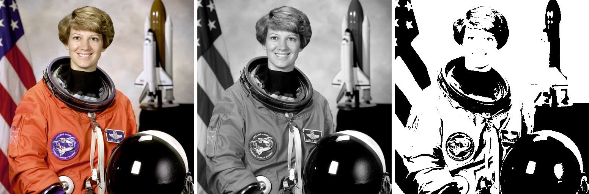

# Redução de dimensionalidade em imagens

Desafio "Redução de Dimensionalidade em Imagens para Redes Neurais", da formação Machine Learning Specialist da DIO. A tarefa é implementar em Python, seguindo o algoritmo de binarização da aula, a transformação de uma imagem colorida em:

1. **níveis de cinza** (0 a 255);
2. **binária** (só 0 e 255, preto e branco).



*Foto: retrato oficial da astronauta Eileen Collins (NASA, domínio público), a mesma imagem de exemplo distribuída pelo scikit-image.*

## Por que isso é "redução de dimensionalidade"

Uma foto colorida tem três números por pixel (vermelho, verde e azul). Em cinza, sobra um número por pixel, de 0 a 255: um terço dos dados. Binarizada, cada pixel vira uma decisão de sim ou não. Para uma rede neural, isso significa menos entradas e menos parâmetros, quando a cor não importa para o problema.

## Como foi feito

A conversão é escrita à mão com NumPy, sem funções prontas de processamento de imagem. O Pillow só lê e grava os arquivos.

**Cinza.** Média ponderada dos canais com os pesos de luminância da recomendação ITU-R BT.601: `0,299·R + 0,587·G + 0,114·B`. Os pesos não são iguais porque o olho percebe o verde como mais claro que o azul na mesma intensidade. Uma média simples deixaria céus e roupas azuis claros demais.

**Binária.** Cada pixel em cinza acima do limiar vira 255 (branco), e o resto, 0 (preto). O limiar pode ser fixo (`--limiar 128`, como no exemplo da aula) ou escolhido automaticamente pelo **método de Otsu**, implementado em `limiar_otsu`. O método testa os 256 cortes possíveis e fica com o que melhor separa os pixels em dois grupos, maximizando a variância entre as classes. Na foto acima, ele escolheu 100.

## Rodando

Com Python 3.10 ou mais novo:

```bash
pip install -e .
python -m reducao exemplos/astronauta.png              # limiar automático (Otsu)
python -m reducao minha-foto.jpg --limiar 128 --saida resultados/
```

Para cada foto, o programa gera `NOME_cinza.png`, `NOME_binaria.png` e `NOME_comparacao.png`, com as três versões lado a lado. Aceita qualquer formato que o Pillow leia (JPEG, PNG, WebP...).

Também dá para usar como biblioteca:

```python
from reducao import para_cinza, binarizar
from reducao.imagem import carregar

cinza = para_cinza(carregar("foto.jpg"))
pb = binarizar(cinza)  # Otsu
pb128 = binarizar(cinza, 128)  # limiar fixo
```

## Testes

```bash
pip install -e '.[dev]'
pytest
```

Os testes conferem os pesos de luminância pixel a pixel, o formato de saída, que a imagem binária só tem 0 e 255, o Otsu numa imagem com dois grupos conhecidos (e numa de cor única) e a linha de comando de ponta a ponta. O GitHub Actions roda lint e testes a cada push.
